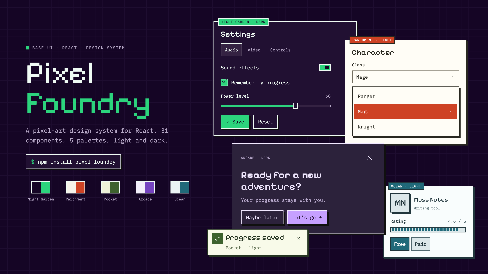
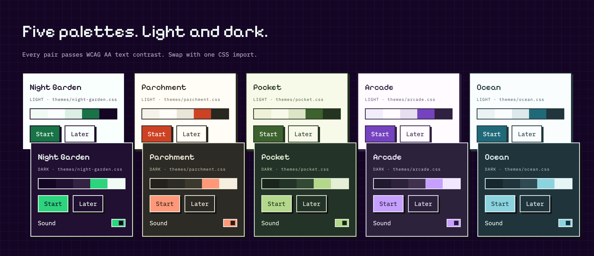

# Pixel Foundry

[](https://www.npmjs.com/package/@ai-atlaas/pixel-foundry)

**A pixel-art design system for React, built on [Base UI](https://base-ui.com).**

Crisp pixel borders, hard offset shadows, bitmap icons and cursors, and a pixel display font, on top of accessible, unstyled Base UI primitives. Includes 31 components, 5 palettes with light and dark modes, and shadcn-compatible design tokens.



```bash
npm install @ai-atlaas/pixel-foundry @base-ui/react
```

```tsx
import '@ai-atlaas/pixel-foundry/styles.css';
import '@ai-atlaas/pixel-foundry/themes/night-garden.css';
import { PixelButton, PixelSwitch, Icon } from '@ai-atlaas/pixel-foundry';

export function App() {
  return (
    <>
      <PixelButton><Icon name="plus" size={12} /> Press start</PixelButton>
      <PixelSwitch label="Sound effects" defaultChecked />
    </>
  );
}
```

Add `class="dark"` to `<html>` for dark mode.

## Features

- **31 components:** buttons, form controls, overlays, menus and display pieces. Each one wraps Base UI, so keyboard, focus and ARIA behavior come built in.
- **5 palettes:** Night Garden, Parchment, Pocket, Arcade and Ocean, each with a paired light and dark mode that passes WCAG AA text contrast.
- **Adjustable geometry:** border width, shadow depth and control density are system-wide tokens.
- **Runtime theming** with `applyTheme()`, or static CSS files with no JavaScript.
- **shadcn-compatible tokens** (`--background`, `--primary`, …), so shadcn components pick up the palette too.
- **Self-hosted open fonts** (Pixelify Sans and IBM Plex Mono) and **Pixelarticons** icons.
- **Typed:** every component prop, icon name and theme setting has a TypeScript type.



## Documentation

The full docs live in [`docs/`](docs/README.md) (GitBook format):

| | |
| --- | --- |
| **Getting started** | [Quick start](docs/getting-started/quick-start.md) · [Installation](docs/getting-started/installation.md) · [Theming](docs/getting-started/theming.md) |
| **Components** | [Overview](docs/components/README.md) · [Button](docs/components/button.md) · [Select](docs/components/select.md) · [Modal](docs/components/modal.md) · [Icons](docs/components/icons.md) · [Raw Base UI](docs/components/styling-base-ui.md) · and every other component on its own page |
| **Design system** | [Principles](docs/design-system/README.md) · [Tokens](docs/design-system/tokens.md) · [Palettes](docs/design-system/palettes.md) · [Typography](docs/design-system/typography.md) · [Cursors & effects](docs/design-system/cursors-and-effects.md) · [Accessibility](docs/design-system/accessibility.md) |
| **Resources** | [Fonts](docs/resources/fonts.md) · [Icon pack](docs/resources/icon-pack.md) · [Research & sources](docs/resources/research-and-sources.md) · [License](docs/resources/license.md) |
| **Contributing** | [Development](docs/contributing/development.md) · [Changelog](docs/contributing/changelog.md) |

## Repository layout

```
├── src/          React components, icons and the theme engine
├── styles/       component stylesheet and bundled fonts
├── scripts/      style build step and release scripts
├── test/         palette contrast and token tests
├── docs/         GitBook documentation (configured by docs/gitbook-docs.yaml)
└── gitbook-integration/  GitBook integration that serves the live component demos
```

## Development

```bash
npm install
npm run typecheck
npm run build
npm test
```

See [Development](docs/contributing/development.md) for adding components, editing palettes and publishing.

## License

[MIT](LICENSE). Icons from [Pixelarticons](https://pixelarticons.com) (MIT). Fonts: Pixelify Sans and IBM Plex Mono (SIL OFL 1.1). See [NOTICE.md](NOTICE.md).
