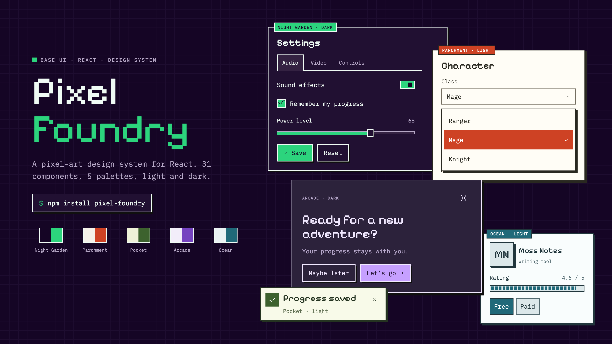
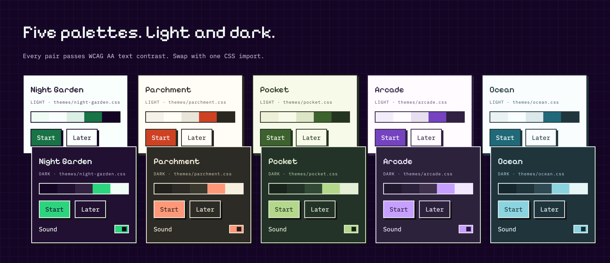

# Introduction



**Pixel Foundry** is a small design system with a big personality: crisp pixel borders, hard offset shadows, bitmap icons and cursors, and a pixel display font. All of it sits on top of the accessible, unstyled primitives of [Base UI](https://base-ui.com).

```tsx
import '@ai-atlaas/pixel-foundry/styles.css';
import '@ai-atlaas/pixel-foundry/themes/night-garden.css';
import { PixelButton } from '@ai-atlaas/pixel-foundry';

<PixelButton>Press start</PixelButton>
```

## What you get

* **31 React components:** buttons, form controls, overlays, menus and display pieces. See [Components](components/README.md).
* **5 palettes**, each with a paired light and dark mode: Night Garden, Parchment, Pocket, Arcade and Ocean. See [Palettes](design-system/palettes.md).

  
* **shadcn-compatible tokens.** The color variables use the same names as shadcn/ui, so existing shadcn components pick up the palette too. See [Design tokens](design-system/tokens.md).
* **Adjustable pixel geometry:** border width, shadow depth and control density are system-wide settings.
* **Self-hosted open fonts** (Pixelify Sans and IBM Plex Mono) and **Pixelarticons** UI icons. See [Resources](resources/fonts.md).
* **Runtime theming** with `applyTheme()`, or static CSS files with no JavaScript.

## How it is built

| Layer | Responsibility | Provided by |
| --- | --- | --- |
| Behavior | Keyboard navigation, focus, ARIA, positioning, open/close state | `@base-ui/react` |
| Look | Pixel geometry, states, typography | `@ai-atlaas/pixel-foundry/styles.css` (`px-*` classes) |
| Color | Semantic colors and geometry values | `@ai-atlaas/pixel-foundry/themes/*.css` or `applyTheme()` |
| Convenience | Pre-assembled components with sensible markup | `@ai-atlaas/pixel-foundry` React exports |

Because behavior stays in Base UI, Pixel Foundry doesn't re-implement keyboard handling or focus management. It only changes how things look.


New here? Start with the [Quick start](getting-started/quick-start.md). It takes about two minutes.

