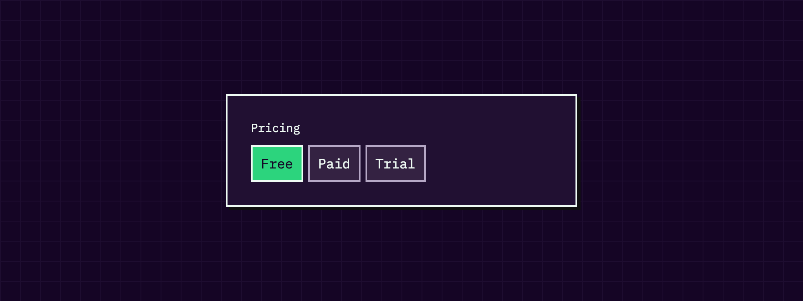

# Toggle group



A row of toggle buttons, for quick filters for example. Only one button can be pressed at a time (Base UI's default), and the value is reported as an array. Arrow keys move between buttons.

## Import

```tsx
import { PixelToggleGroup } from 'pixel-foundry';
```

## Usage

```tsx
<PixelToggleGroup
  label="Pricing"
  defaultValue="free"
  options={[
    { value: 'free', label: 'Free' },
    { value: 'paid', label: 'Paid' },
    { value: 'trial', label: 'Trial' },
  ]}
  onValueChange={(values) => setPricing(values)}
/>
```

## Props

| Prop | Type | Description |
| --- | --- | --- |
| `label` | `string` | Accessible name of the group |
| `options` | `{ value: string; label: string }[]` | Buttons to show |
| `defaultValue` | `string` | Initially pressed value |
| `value` | `string[]` | Controlled pressed values |
| `onValueChange` | `(values: string[]) => void` | Called when the selection changes |
