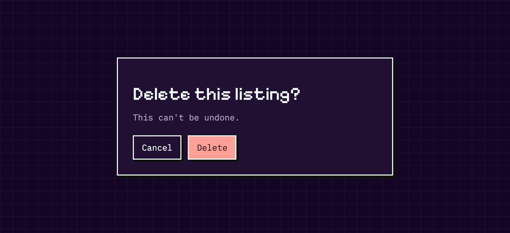

# Alert dialog



A confirmation dialog for destructive actions. It renders its own trigger button. Focus starts on **Cancel**, so a stray <kbd>Enter</kbd> can't confirm by accident.

## Import

```tsx
import { PixelAlertDialog } from 'pixel-foundry';
```

## Usage

```tsx
<PixelAlertDialog
  trigger="Delete listing"
  title="Delete this listing?"
  description="This can't be undone."
  confirm="Delete"
  onConfirm={deleteListing}
/>
```

## Props

| Prop | Type |
| --- | --- |
| `trigger` | `string` (trigger button text) |
| `title` | `string` |
| `description` | `string` |
| `confirm` | `string` (confirm button text) |
| `onConfirm` | `() => void` |
