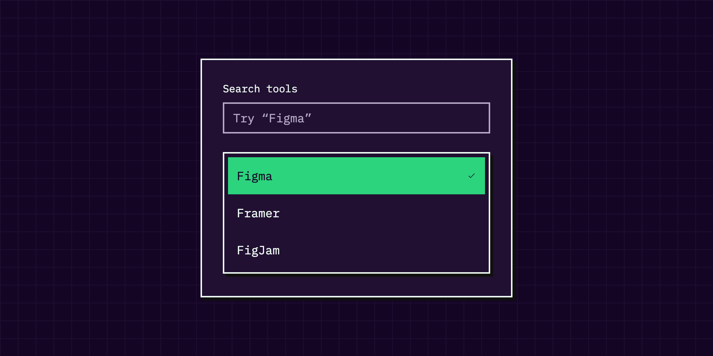

# Autocomplete



A free-text input with suggestions. Unlike a combobox, any text is a valid value.

## Import

```tsx
import { PixelAutocomplete } from 'pixel-foundry';
```

## Usage

```tsx
<PixelAutocomplete
  label="Search tools"
  items={['Figma', 'Linear', 'Notion']}
  placeholder="Try “Figma”"
  onValueChange={setQuery}
/>
```

## Props

| Prop | Type | Default |
| --- | --- | --- |
| `label` | `string` | |
| `items` | `string[]` | |
| `value` | `string` | |
| `onValueChange` | `(value: string) => void` | |
| `placeholder` | `string` | `'Search…'` |
