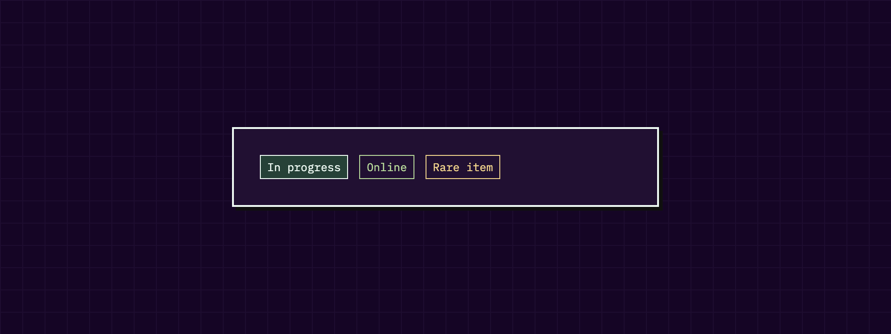

# Badge



Badges are a CSS class, not a component.

## Usage

```tsx
<span className="px-badge">In progress</span>
<span className="px-badge success">Online</span>
<span className="px-badge warning">Rare item</span>
```
