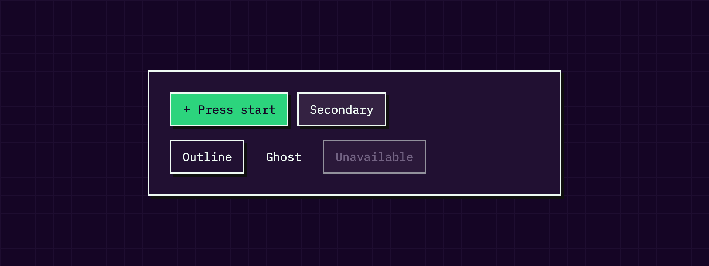

# Button



A button with a pixel border and a hard shadow. When pressed, it moves into its own shadow.

## Import

```tsx
import { PixelButton } from 'pixel-foundry';
```

## Usage

```tsx
import { PixelButton, Icon } from 'pixel-foundry';

<PixelButton onClick={start}><Icon name="plus" size={12} /> Press start</PixelButton>
<PixelButton variant="secondary">Secondary</PixelButton>
<PixelButton variant="outline">Outline</PixelButton>
<PixelButton variant="ghost">Ghost</PixelButton>
<PixelButton disabled>Unavailable</PixelButton>
```

## Props

| Prop | Type | Default | Description |
| --- | --- | --- | --- |
| `variant` | `'primary' \| 'secondary' \| 'outline' \| 'ghost'` | `'primary'` | Visual style |
| `className` | `string` | | Extra classes |
| …rest | Base UI `Button` props | | `onClick`, `disabled`, `type`, `render`, … |
