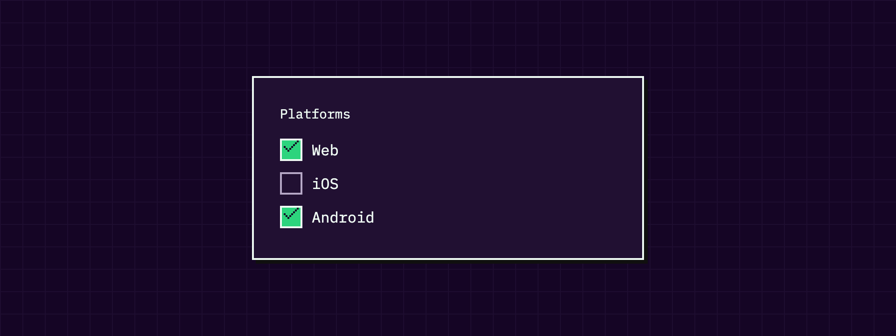

# Checkbox group



A labelled list of checkboxes that share one array value.

## Import

```tsx
import { PixelCheckboxGroup } from 'pixel-foundry';
```

## Usage

```tsx
<PixelCheckboxGroup
  label="Platforms"
  options={['Web', 'iOS', 'Android']}
  defaultValue={['Web']}
  onValueChange={setPlatforms}
/>
```

## Props

| Prop | Type |
| --- | --- |
| `label` | `string` |
| `options` | `string[]` (each string is both value and label) |
| `defaultValue` | `string[]` |
| `value` | `string[]` |
| `onValueChange` | `(values: string[]) => void` |
