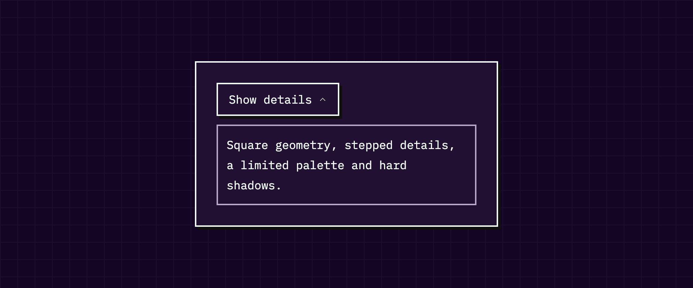

# Collapsible



A button that shows and hides a panel.

## Import

```tsx
import { PixelCollapsible } from '@ai-atlaas/pixel-foundry';
```

## Usage

```tsx
<PixelCollapsible label="Show details">
  <p>Hidden until opened.</p>
</PixelCollapsible>
```

## Props

| Prop | Type |
| --- | --- |
| `label` | `string` |
| `children` | `ReactNode` |
