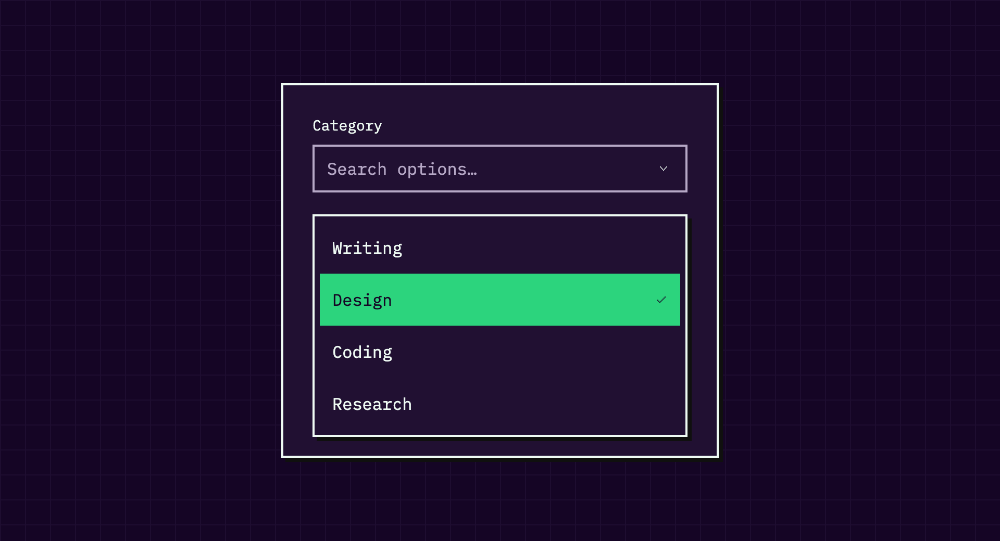

# Combobox



A searchable single-select with a clear button. The list filters as you type, and only listed values can be chosen.

## Import

```tsx
import { PixelCombobox } from 'pixel-foundry';
```

## Usage

```tsx
<PixelCombobox label="Category" items={['Writing', 'Design', 'Coding', 'Research']} />
```

## Props

| Prop | Type | Default |
| --- | --- | --- |
| `label` | `string` | |
| `items` | `string[]` | |
| `placeholder` | `string` | `'Search options…'` |
