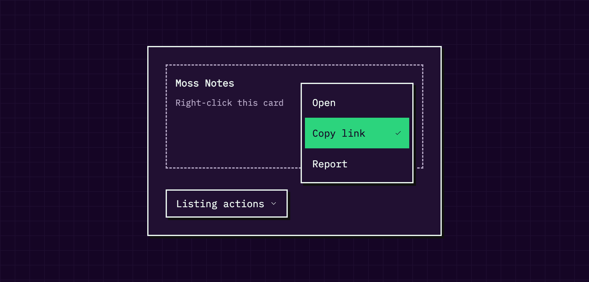

# Context menu



Shows a menu on right-click or long-press of its children. Right-click can't be reached by keyboard or by everyone on touch, so the component also renders a regular menu button with the same actions.

## Import

```tsx
import { PixelContextMenu } from 'pixel-foundry';
```

## Usage

```tsx
<PixelContextMenu
  menuLabel="Listing actions"
  actions={[
    { label: 'Open', onSelect: open },
    { label: 'Copy link', onSelect: copy },
    { label: 'Report', onSelect: report },
  ]}
>
  <div>Right-click this card</div>
</PixelContextMenu>
```

## Props

| Prop | Type | Default |
| --- | --- | --- |
| `children` | `ReactNode` | |
| `actions` | `MenuAction[]` | |
| `menuLabel` | `string` | `'Actions'` |
