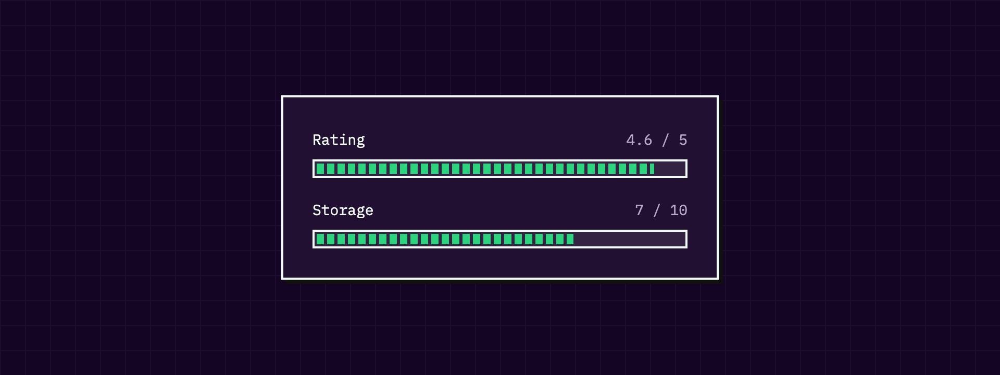

# Meter



Shows a measured value within a known range, such as a rating or storage used. For task progress, use Base UI's `Progress` instead (see [Styling raw Base UI parts](../styling-base-ui.md#progress)).

## Import

```tsx
import { PixelMeter } from 'pixel-foundry';
```

## Usage

```tsx
<PixelMeter label="Rating" value={4.6} max={5} unit="stars" />
```

## Props

| Prop | Type | Description |
| --- | --- | --- |
| `label` | `string` | |
| `value` | `number` | Clamped to `0…max` |
| `max` | `number` | |
| `unit` | `string` | Optional, read by screen readers ("4.6 out of 5 stars") |
