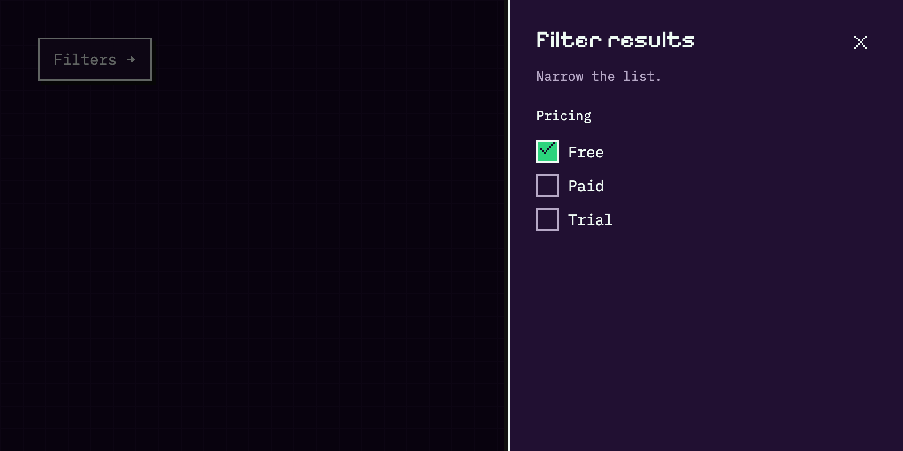

# Drawer



A side panel that slides in from the right and can be swiped closed on touch devices. It renders its own trigger button.

## Import

```tsx
import { PixelDrawer } from 'pixel-foundry';
```

## Usage

```tsx
<PixelDrawer trigger="Filters" title="Filter results" description="Narrow the list.">
  <PixelCheckboxGroup label="Pricing" options={['Free', 'Paid']} />
</PixelDrawer>
```

## Props

| Prop | Type |
| --- | --- |
| `trigger` | `string` |
| `title` | `string` |
| `description` | `string` |
| `children` | `ReactNode` |
