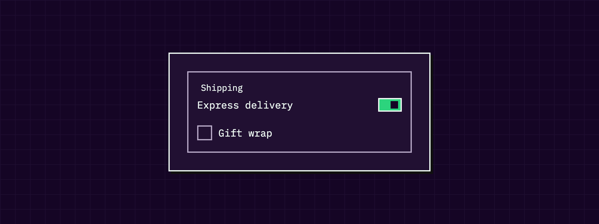

# Fieldset



Groups related fields under a legend. Setting `disabled` disables every control inside.

## Import

```tsx
import { PixelFieldset } from 'pixel-foundry';
```

## Usage

```tsx
<PixelFieldset legend="Shipping" disabled={!editing}>
  <PixelSwitch label="Express delivery" />
  <PixelCheckbox>Gift wrap</PixelCheckbox>
</PixelFieldset>
```

## Props

| Prop | Type |
| --- | --- |
| `legend` | `string` |
| `disabled` | `boolean` |
| `children` | `ReactNode` |
