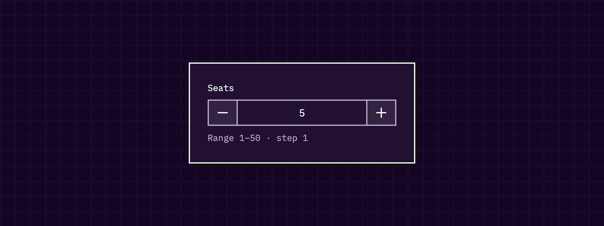

# Number field



A number input with − and + buttons and a hint showing the allowed range.

## Import

```tsx
import { PixelNumberField } from 'pixel-foundry';
```

## Usage

```tsx
<PixelNumberField label="Seats" min={1} max={50} defaultValue={5} />
```

## Props

| Prop | Type | Default |
| --- | --- | --- |
| `label` | `string` | |
| `min`, `max` | `number` | |
| `defaultValue` | `number` | |
| `step` | `number` | `1` |
