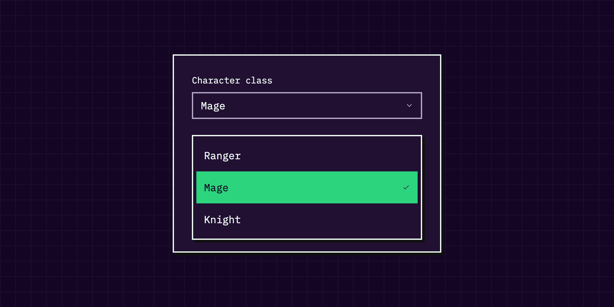

# Select



A controlled dropdown select with full keyboard support.

## Import

```tsx
import { PixelSelect } from 'pixel-foundry';
```

## Usage

```tsx
const [role, setRole] = useState('ranger');

<PixelSelect
  label="Character class"
  value={role}
  onChange={setRole}
  options={[
    { label: 'Ranger', value: 'ranger' },
    { label: 'Mage', value: 'mage' },
    { label: 'Knight', value: 'knight' },
  ]}
/>
```

## Props

| Prop | Type |
| --- | --- |
| `label` | `string` |
| `value` | `string` |
| `options` | `SelectOption[]`, i.e. `{ label: string; value: string }[]` |
| `onChange` | `(value: string) => void` |
