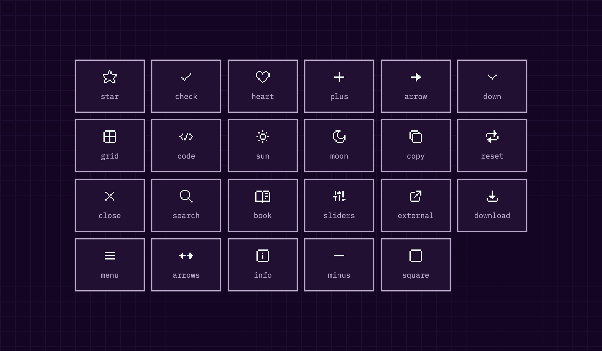

# Icons



`Icon` renders a [Pixelarticons](https://pixelarticons.com) icon. The icon inherits the current text color.

```tsx
import { Icon } from '@ai-atlaas/pixel-foundry';

<Icon name="star" />          // 24px
<Icon name="check" size={12} /> // compact 12px
```

| Prop | Type | Default | Description |
| --- | --- | --- | --- |
| `name` | `IconName` | `'star'` | Which icon to show |
| `size` | `number` | `24` | Snapped to 12, 24 or 48px so strokes stay crisp |

Icons are decorative (`aria-hidden`). When an icon is a button's only content, give the button an `aria-label`.

## Available names

| Name | Pixelarticons icon | Name | Pixelarticons icon |
| --- | --- | --- | --- |
| `star` | Star | `close` | Close |
| `check` | Check | `search` | Search |
| `heart` | Heart | `book` | BookOpen |
| `plus` | Plus | `sliders` | Sliders |
| `minus` | Minus | `external` | ExternalLink |
| `arrow` | ArrowRight | `download` | Download |
| `arrows` | ArrowsHorizontal | `menu` | Menu |
| `down` | ChevronDown | `info` | InfoBox |
| `grid` | Grid2x22 | `copy` | Copy |
| `code` | Code | `reset` | Reload |
| `sun` | Sun | `square` | Square |
| `moon` | Moon | | |

The list is also exported at runtime as `iconNames`.

## Using other Pixelarticons icons

`pixelarticons` is installed with Pixel Foundry, so you can import any other icon from the set directly:

```tsx
import { Trophy } from 'pixelarticons/react/Trophy.js';

<Trophy width={24} height={24} shapeRendering="crispEdges" aria-hidden="true" />
```

Use sizes of 12, 24 or 48px so the pixel grid lines up. See [Icon pack](../resources/icon-pack.md) for license details.
