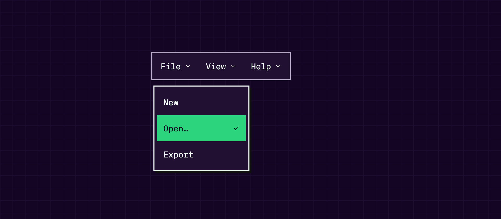

# Menubar



A desktop-style menu bar. Use the arrow keys to move between menus and items.

## Import

```tsx
import { PixelMenubar } from 'pixel-foundry';
```

## Usage

```tsx
<PixelMenubar
  label="Editor"
  groups={[
    { label: 'File', actions: [{ label: 'New', onSelect: create }, { label: 'Export', onSelect: exportFile }] },
    { label: 'View', actions: [{ label: 'Grid', onSelect: showGrid }, { label: 'List', onSelect: showList }] },
  ]}
/>
```

## Props

| Prop | Type |
| --- | --- |
| `label` | `string` |
| `groups` | `{ label: string; actions: MenuAction[] }[]` |
