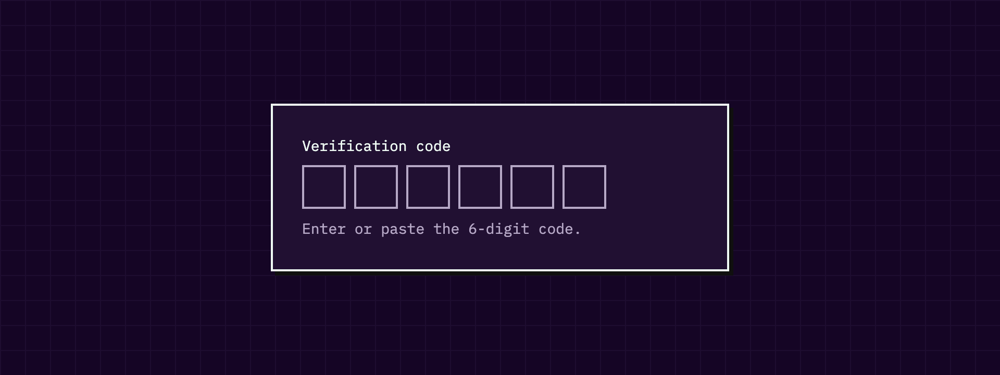

# OTP field



A one-time-code input with one box per digit. Pasting a whole code fills every box.

## Import

```tsx
import { PixelOTPField } from 'pixel-foundry';
```

## Usage

```tsx
<PixelOTPField label="Verification code" length={6} />
```

## Props

| Prop | Type | Default |
| --- | --- | --- |
| `label` | `string` | |
| `length` | `number` | `6` |
