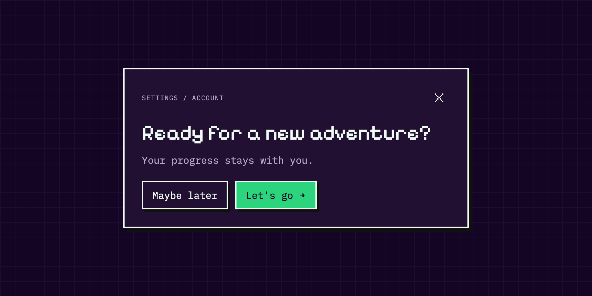

# Modal



A controlled dialog with a title, an optional description and a close button.

## Import

```tsx
import { PixelModal } from 'pixel-foundry';
```

## Usage

```tsx
const [open, setOpen] = useState(false);

<PixelButton onClick={() => setOpen(true)}>Open</PixelButton>
<PixelModal
  open={open}
  onOpenChange={setOpen}
  eyebrow="SETTINGS / ACCOUNT"
  title="Ready for a new adventure?"
  description="Your progress stays with you."
>
  <PixelButton onClick={() => setOpen(false)}>Let's go</PixelButton>
</PixelModal>
```

## Props

| Prop | Type | Description |
| --- | --- | --- |
| `open` | `boolean` | Whether the dialog is open |
| `onOpenChange` | `(open: boolean) => void` | Called on close button, <kbd>Esc</kbd> or backdrop click |
| `title` | `string` | Dialog heading, used as its accessible name |
| `description` | `string` | Optional supporting text |
| `eyebrow` | `string` | Optional small label above the title |
| `children` | `ReactNode` | Body and actions |
