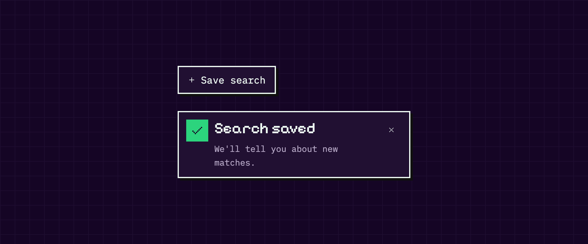

# Toast



A button that shows a toast notification. Only one toast is shown at a time, and it hides after 6 seconds.

## Import

```tsx
import { PixelToastTrigger } from 'pixel-foundry';
```

## Usage

```tsx
<PixelToastTrigger label="Save search" title="Search saved" description="We'll tell you about new matches." />
```

## Props

| Prop | Type |
| --- | --- |
| `label` | `string` (button text) |
| `title` | `string` |
| `description` | `string` |


To show toasts from anywhere in your app (after a network request, say), use Base UI's `Toast.Provider` and `Toast.useToastManager()` with the `px-toast-viewport`, `px-toast-content`, `px-toast-mark` and `px-toast-message` classes.

