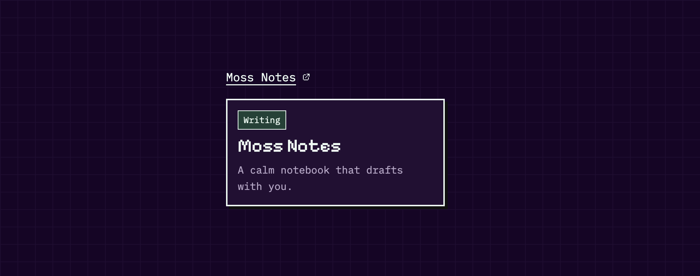

# Preview card



A link that shows a preview card when hovered or focused.

## Import

```tsx
import { PixelPreviewCard } from '@ai-atlaas/pixel-foundry';
```

## Usage

```tsx
<PixelPreviewCard
  label="Moss Notes"
  href="/tools/moss-notes"
  category="Writing"
  description="A calm notebook that drafts with you."
/>
```

## Props

| Prop | Type |
| --- | --- |
| `label` | `string` (link text) |
| `href` | `string` |
| `category` | `string` (badge) |
| `description` | `string` |
