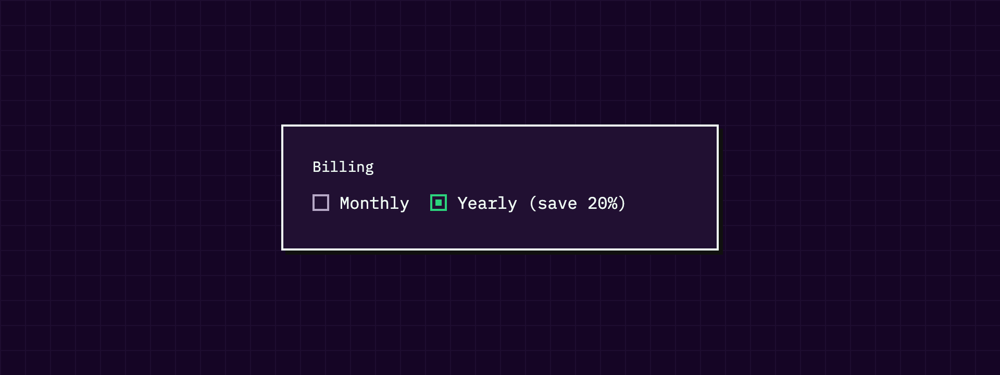

# Radio group



A controlled radio group with a visible group label.

## Import

```tsx
import { PixelRadioGroup } from 'pixel-foundry';
```

## Usage

```tsx
const [billing, setBilling] = useState('monthly');

<PixelRadioGroup
  label="Billing"
  value={billing}
  onValueChange={setBilling}
  options={[
    { value: 'monthly', label: 'Monthly' },
    { value: 'yearly', label: 'Yearly (save 20%)' },
  ]}
/>
```

## Props

| Prop | Type |
| --- | --- |
| `label` | `string` |
| `options` | `{ value: string; label: string }[]` |
| `value` | `string` |
| `onValueChange` | `(value: string) => void` |
