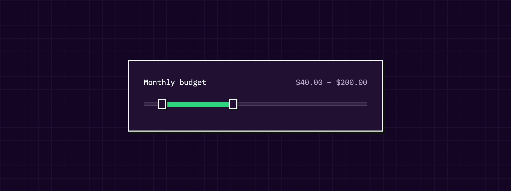

# Range slider



A two-thumb slider for a range of money. The values are formatted as currency.

## Import

```tsx
import { PixelRangeSlider } from 'pixel-foundry';
```

## Usage

```tsx
<PixelRangeSlider label="Monthly budget" min={0} max={500} step={10} initial={[40, 200]} currency="EUR" />
```

## Props

| Prop | Type | Default |
| --- | --- | --- |
| `label` | `string` | |
| `min`, `max` | `number` | |
| `step` | `number` | `1` |
| `initial` | `[number, number]` | |
| `currency` | ISO 4217 code | `'USD'` |


`PixelRangeSlider` is uncontrolled. To read the values, use Base UI's `Slider` with the classes `px-slider px-range-slider`, `px-track`, `px-indicator` and `px-thumb`.

