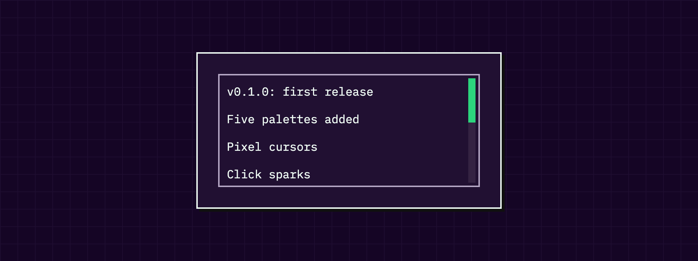

# Scroll area



A scroll container with a pixel scrollbar. Give it a height with CSS.

## Import

```tsx
import { PixelScrollArea } from 'pixel-foundry';
```

## Usage

```tsx
<PixelScrollArea label="Changelog">
  {entries.map((e) => <p key={e.id}>{e.text}</p>)}
</PixelScrollArea>
```

## Props

| Prop | Type | Description |
| --- | --- | --- |
| `label` | `string` | Accessible name of the scroll region |
| `children` | `ReactNode` | |
