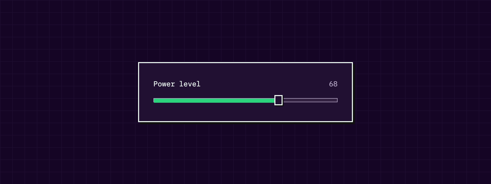

# Slider



## Import

```tsx
import { PixelSlider } from '@ai-atlaas/pixel-foundry';
```

## Usage

```tsx
const [power, setPower] = useState(68);

<PixelSlider label="Power level" value={power} onChange={setPower} />
```

## Props

| Prop | Type | Default |
| --- | --- | --- |
| `label` | `string` | |
| `value` | `number` | |
| `onChange` | `(value: number) => void` | |
| `min` | `number` | `0` |
| `max` | `number` | `100` |
| `step` | `number` | `1` |
