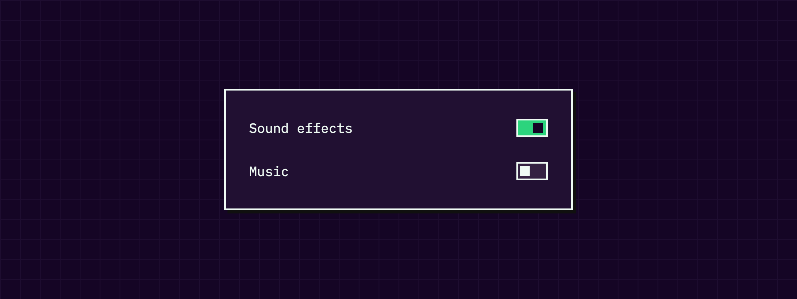

# Switch



## Import

```tsx
import { PixelSwitch } from 'pixel-foundry';
```

## Usage

```tsx
<PixelSwitch label="Sound effects" defaultChecked />
```

## Props

| Prop | Type | Description |
| --- | --- | --- |
| `label` | `string` | Visible label, shown before the switch |
| …rest | Base UI `Switch.Root` props | `checked`, `defaultChecked`, `onCheckedChange`, `disabled`, … |
