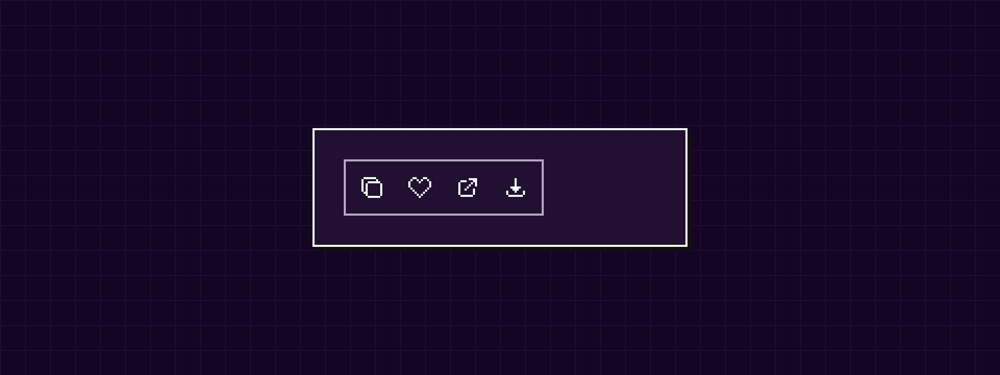

# Toolbar



A row of icon buttons with arrow-key navigation between them.

## Import

```tsx
import { PixelToolbar } from '@ai-atlaas/pixel-foundry';
```

## Usage

```tsx
<PixelToolbar
  label="Listing actions"
  actions={[
    { label: 'Copy link', icon: 'copy', onClick: copyLink },
    { label: 'Save', icon: 'heart', onClick: save },
    { label: 'Share', icon: 'external', onClick: share },
  ]}
/>
```

## Props

| Prop | Type |
| --- | --- |
| `label` | `string` |
| `actions` | `{ label: string; icon: IconName; onClick: () => void }[]` |

Each action's `label` becomes the button's accessible name. See [Icons](icons.md) for the available `icon` values.
