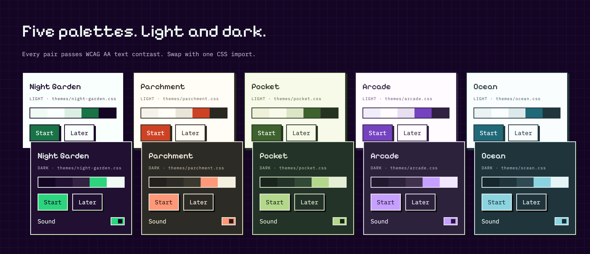

# Palettes



Pixel Foundry ships five palettes. Each has a light and a dark variant that were designed as a pair, not generated by inverting colors.

```tsx
import '@ai-atlaas/pixel-foundry/themes/night-garden.css'; // default
import '@ai-atlaas/pixel-foundry/themes/parchment.css';
import '@ai-atlaas/pixel-foundry/themes/pocket.css';
import '@ai-atlaas/pixel-foundry/themes/arcade.css';
import '@ai-atlaas/pixel-foundry/themes/ocean.css';
```

| Palette | Mood | Light primary | Dark primary |
| --- | --- | --- | --- |
| **Night Garden** | Mint pixels after midnight. Mint `#2CD47D` on deep purple `#150525` | `#187346` | `#2cd47d` |
| **Parchment** | Warm cream, charcoal and persimmon. An editorial workspace | `#ce4224` | `#ff9879` |
| **Pocket** | Pale green and forest ink. A handheld-console reference | `#3d622e` | `#b4d88b` |
| **Arcade** | Lavender and violet. The most expressive palette | `#7543c0` | `#c6a0ff` |
| **Ocean** | Cool paper and teal. A quieter alternative | `#206979` | `#8bd4df` |

Every palette passes WCAG AA (at least 4.5:1) for body text, muted text and button text, in both modes. The test suite checks this on every build (see [Accessibility](accessibility.md)).


Night Garden's light variant uses a darker green (`#187346`) instead of the signature mint, because mint on a pale background doesn't have enough contrast for text.


Shared across all palettes: `--destructive`, `--success` and `--warning` use the same values everywhere, so status colors mean the same thing in every theme.

## Values

The tables below come straight from `src/theme.ts`.

### Night Garden

_Mint pixels after midnight_

| Token | Light | Dark |
| --- | --- | --- |
| `--background` | `#effbf4` | `#150525` |
| `--card` | `#f9fffc` | `#211032` |
| `--foreground` | `#150525` | `#effbf4` |
| `--muted-foreground` | `#62516d` | `#b6a8c6` |
| `--secondary` | `#dcefe4` | `#342242` |
| `--primary` | `#187346` | `#2cd47d` |
| `--primary-foreground` | `#ffffff` | `#150525` |
| `--accent` | `#cbf2dd` | `#264137` |
| `--destructive` | `#ad2c25` | `#ff9f99` |
| `--success` | `#3b6534` | `#b7d89a` |
| `--warning` | `#805c13` | `#efd28b` |

Contrast: text on background 18.31:1 light / 18.31:1 dark · button text on primary 5.87:1 / 10.02:1 · muted text 6.78:1 / 8.71:1

### Parchment

_Warm & wonderfully analog_

| Token | Light | Dark |
| --- | --- | --- |
| `--background` | `#f5f2e9` | `#22211d` |
| `--card` | `#fffdf6` | `#2d2b25` |
| `--foreground` | `#292820` | `#f4efdf` |
| `--muted-foreground` | `#746e60` | `#b9b29f` |
| `--secondary` | `#eae5d9` | `#3b382e` |
| `--primary` | `#ce4224` | `#ff9879` |
| `--primary-foreground` | `#ffffff` | `#281c16` |
| `--accent` | `#f8e5dc` | `#50372c` |
| `--destructive` | `#ad2c25` | `#ff9f99` |
| `--success` | `#3b6534` | `#b7d89a` |
| `--warning` | `#805c13` | `#efd28b` |

Contrast: text on background 13.22:1 light / 14.01:1 dark · button text on primary 4.74:1 / 7.90:1 · muted text 4.53:1 / 7.62:1

### Pocket

_A little handheld nostalgia_

| Token | Light | Dark |
| --- | --- | --- |
| `--background` | `#eef1d8` | `#19251c` |
| `--card` | `#f8fae9` | `#233328` |
| `--foreground` | `#253421` | `#e4efd6` |
| `--muted-foreground` | `#5e6d50` | `#a9be9e` |
| `--secondary` | `#dce5c5` | `#324935` |
| `--primary` | `#3d622e` | `#b4d88b` |
| `--primary-foreground` | `#ffffff` | `#182517` |
| `--accent` | `#d3e4bc` | `#3a5131` |
| `--destructive` | `#ad2c25` | `#ff9f99` |
| `--success` | `#3b6534` | `#b7d89a` |
| `--warning` | `#805c13` | `#efd28b` |

Contrast: text on background 11.44:1 light / 13.32:1 dark · button text on primary 7.04:1 / 9.98:1 · muted text 4.82:1 / 7.97:1

### Arcade

_Insert a little imagination_

| Token | Light | Dark |
| --- | --- | --- |
| `--background` | `#f2edfa` | `#21192d` |
| `--card` | `#fffbff` | `#2c223b` |
| `--foreground` | `#302041` | `#f1e8ff` |
| `--muted-foreground` | `#705f7e` | `#baabce` |
| `--secondary` | `#e7def0` | `#40324e` |
| `--primary` | `#7543c0` | `#c6a0ff` |
| `--primary-foreground` | `#ffffff` | `#281737` |
| `--accent` | `#e7d9fa` | `#4c3567` |
| `--destructive` | `#ad2c25` | `#ff9f99` |
| `--success` | `#3b6534` | `#b7d89a` |
| `--warning` | `#805c13` | `#efd28b` |

Contrast: text on background 12.97:1 light / 14.28:1 dark · button text on primary 6.32:1 / 7.79:1 · muted text 5.04:1 / 7.90:1

### Ocean

_Fresh from the save point_

| Token | Light | Dark |
| --- | --- | --- |
| `--background` | `#eaf2f3` | `#17272e` |
| `--card` | `#f9fdfd` | `#20343c` |
| `--foreground` | `#21363c` | `#e6f5f5` |
| `--muted-foreground` | `#536a70` | `#a0bcc5` |
| `--secondary` | `#dce8ea` | `#304a53` |
| `--primary` | `#206979` | `#8bd4df` |
| `--primary-foreground` | `#ffffff` | `#162e33` |
| `--accent` | `#d4e8ec` | `#31515b` |
| `--destructive` | `#ad2c25` | `#ff9f99` |
| `--success` | `#3b6534` | `#b7d89a` |
| `--warning` | `#805c13` | `#efd28b` |

Contrast: text on background 11.16:1 light / 13.72:1 dark · button text on primary 6.25:1 / 8.54:1 · muted text 5.05:1 / 7.68:1

## Making your own palette

Override the color tokens after importing any theme file:

```css
:root {
  --background: #fdf6e3;
  --card: #ffffff;
  --foreground: #1f1a14;
  --muted-foreground: #6b6257;
  --secondary: #efe6d2;
  --primary: #2a6fdb;
  --primary-foreground: #ffffff;
  --accent: #dde9fb;
}
.dark {
  /* …the dark counterparts… */
}
```

Or set only an accent at runtime with `applyTheme({ accent: '#2a6fdb' })`. The button text color is chosen for contrast automatically. Check your custom colors with a contrast checker: the automatic choice covers button text only, not every surface combination.
